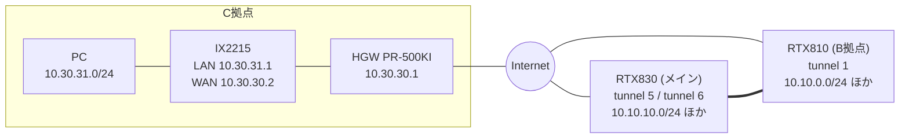

# NEC IX2215 を HGW(PR-500KI)配下に置き、Yamaha RTX830/RTX810 と拠点間 IPsec VPN(IKEv1・NAT-T)+ IPv6(DHCPv6-PD)を構築した記録

フレッツ光(ひかり電話)の HGW 配下に NEC IX2215 を置き、既存の Yamaha RTX830(メイン)・RTX810(B拠点)と
**3拠点フルメッシュ相当**の拠点間 VPN を組んだときの、最終設定と試行錯誤の記録です。  
あわせて、C拠点の LAN から **IPv6 でインターネットへ出る**(HGW からの DHCPv6-PD)設定も載せています。  
この記事はAIで作成しました。

> DDNS 名・事前共有鍵・アドレス・パスワードは伏字または例示用の値です。LAN/WAN の IPv4 アドレスには実環境と異なるプライベートアドレスを使っています。`<...>` や `example` を含め、設定値は自分の環境に合わせて置き換えてください。  
> `203.0.113.0/24` は文書用の予約アドレスで、NTP/DNS サーバーとしては使えません。実際に到達可能なサーバーのアドレスに置き換えてください。

## 目次

1. [構成](#構成)
2. [最終設定](#最終設定)
3. [動作確認](#動作確認)
4. [トンネルが切れたまま戻らない問題(常時接続化)](#トンネルが切れたまま戻らない問題常時接続化)
5. [IPv6(DHCPv6-PD)](#ipv6dhcpv6-pd)
6. [試行錯誤の記録(ハマりどころ)](#試行錯誤の記録ハマりどころ)
7. [切り分けの進め方](#切り分けの進め方)
8. [セキュリティ上の注意](#セキュリティ上の注意)
9. [参考](#参考)

## 構成

| 拠点 | 機器 | 回線 | LAN |
|---|---|---|---|
| メイン | Yamaha RTX830 (Rev.15.02.33) | PPPoE(OCN・動的IP)+ DDNS(ネットボランチ) | 10.10.10.0/24、VLAN 10.10.110.0/24、VLAN 10.10.20.0/24 |
| B | Yamaha RTX810 | CATV(WAN はプライベートアドレス) | 10.10.0.0/24、VLAN 10.10.100/101/102.0/24 |
| C(新設) | NEC IX2215 (10.11.18) | フレッツ光 + ひかり電話、HGW: PR-500KI | 10.30.31.0/24(WAN 側は HGW 配下 10.30.30.0/24) |

- メイン↔B は既存の VPN(RTX830 の tunnel 5 / RTX810 の tunnel 1)。
- C↔メインは新設(RTX830 の tunnel 6 / IX の Tunnel0.0)。C↔B は **メイン経由**(ハブ&スポーク)で通します。
- IX は HGW の LAN ポートに WAN をつなぐ二重 NAT 構成です。**HGW は無設定**(ポート開放・DMZ なし)で、IKE は NAT-T(UDP 4500)で張れます。
- IX からメインへは、DDNS 名宛てに IKE を開始する(IX がイニシエータ)。メインの RTX830 は PPPoE 側で受けた UDP 500/4500/ESP を、NAT 静的で VPN 終端(10.10.110.1)へ転送しています。



## 最終設定

### NEC IX2215(C拠点)

```text
hostname <自分で決めたID>
timezone +09 00
!
ntp server 203.0.113.10
ntp server 203.0.113.11
ntp server 203.0.113.12
ntp retry 10
ntp interval 3600
!
ip route default 10.30.30.1
ip route 10.10.0.0/16 Tunnel0.0
ip dhcp enable
ip name-server 203.0.113.53
!
ip access-list sec-list1 permit ip src any dest any
ip access-list ssh-pass permit tcp src 10.30.31.0/24 sport any dest any dport eq 22
ip access-list ssh-pass permit tcp src 10.10.10.0/24 sport any dest any dport eq 22
ip access-list ssh-pass deny ip src any dest any
ssh-server ip access-list ssh-pass
!
ike proposal ike-prop encryption aes hash sha group 1024-bit
ike policy ike-pol peer-fqdn-ipv4 example.aa0.netvolante.jp key <PRE_SHARED_KEY> ike-prop mode aggressive
ike keepalive ike-pol 10 3
ike local-id ike-pol fqdn <自分で決めたID>
ike nat-traversal policy ike-pol
!
ipsec autokey-proposal ipsec-prop esp-aes esp-sha
ipsec autokey-map ipsec-map sec-list1 peer-fqdn-ipv4 example.aa0.netvolante.jp ipsec-prop
!
ip dhcp profile dhcpv4-sv
  assignable-range 10.30.31.101 10.30.31.200
  default-gateway 10.30.31.1
  dns-server 203.0.113.53
!
interface GigaEthernet0.0
  ip address 10.30.30.2/24
  ip napt enable
  no shutdown
!
interface GigaEthernet2.0
  ip address 10.30.31.1/24
  ip dhcp binding dhcpv4-sv
  ssh-server ip enable
  no shutdown
!
interface Tunnel0.0
  tunnel mode ipsec
  ip unnumbered GigaEthernet2.0
  ip tcp adjust-mss auto
  ipsec policy tunnel ipsec-map out
  ssh-server ip enable
  no shutdown
!
network-monitor host enable
watch-group host 10
  event 10 ip unreach-host 10.10.10.1 Tunnel0.0 source GigaEthernet2.0
  probe-timer restorer 60
  probe-timer variance 60
```

ポイント:

- `ike policy` の入力書式は `key <鍵> <proposal名> mode aggressive`。`show running-config` では `mode aggressive` が前に表示されます。**`key ascii <鍵>` と書くと、`ascii` が鍵、本来の鍵が proposal 名として登録されて IKE が始まりません**(後述)。
- 対向が DDNS(動的 IP)なので `peer-fqdn-ipv4` を使います。IKE ID は `ike local-id ... fqdn`(IX に `key-id` はありません)。
- 経路ベース(`Tunnel0.0`)。`ip route 10.10.0.0/16 Tunnel0.0` で、メイン・B 宛てをまとめてトンネルへ。
- `Tunnel0.0` は `ip unnumbered GigaEthernet2.0`。**LAN ポートがリンクダウンだと、LAN 側アドレスが無効になり通信できません**(ラボ試験で遭遇、後述)。
- ssh を使う場合、古めのホスト鍵のみ提示されるため、クライアント側で `-o HostKeyAlgorithms=+ssh-rsa` が必要でした。
- **`network-monitor` / `watch-group` は、VPN を常時接続にするための設定です**(トンネルに通信が流れないと、SA が更新されず切れたままになるため。後述)。

### Yamaha RTX830(メイン)— C拠点用の追加分

```text
tunnel select 6
 description tunnel <自分で決めたID>
 ipsec tunnel 6
  ipsec sa policy 6 6 esp aes-cbc sha-hmac
  ipsec ike encryption 6 aes-cbc
  ipsec ike group 6 modp1024
  ipsec ike hash 6 sha
  ipsec ike keepalive log 6 off
  ipsec ike keepalive use 6 on dpd 10 6
  ipsec ike local address 6 10.10.110.1
  ipsec ike nat-traversal 6 on
  ipsec ike pre-shared-key 6 text <PRE_SHARED_KEY>
  ipsec ike remote address 6 any
  ipsec ike remote name 6 <自分で決めたID> fqdn
 ip tunnel tcp mss limit auto
 tunnel enable 6

ipsec ike payload type 6 3
ip route 10.30.31.0/24 gateway tunnel 6
```

ポイント:

- **`ipsec ike payload type 6 3` が決め手でした**(後述)。
- `remote name` は `key-id` ではなく **`fqdn`**(IX 側の ID が FQDN のため)。
- 相手の IP が不定(HGW 配下・動的)なので `remote address 6 any`。
- 既存の PPPoE 側の NAT 静的(UDP 500 / UDP 4500 / ESP → 10.10.110.1)は、B拠点用にすでに入っているものをそのまま使います。
- トンネル 5 と 6 に互いを遮るフィルタを付けていないので、**B↔C はメイン経由でそのまま通ります**。
- 切り分け中だけ `ipsec ike log 6` で詳細ログを取り、終わったら `no ipsec ike log 6` で止めます。

### Yamaha RTX810(B拠点)— C拠点用の追加分

```text
ip route 10.30.31.0/24 gateway tunnel 1
```

注意: **B拠点自身の LAN(10.10.0.0/24)をトンネルへ向ける静的ルートを入れてはいけません**。
`ip route 10.10.0.0/24 gateway tunnel 1` が残っていたため、C から B の LAN 内ホストへの通信がメイン↔B 間でループしました(後述)。

## 動作確認

IX で:

```text
show ike sa          # State is established、NAT-Traversal の表示、ph1/ph2 success
show ipsec sa        # UDP encapsulation Tunnel mode(NAT-T 時)、ESP の SPI が双方向
ping 10.10.10.1 source 10.30.31.1
ping 10.10.0.200 source 10.30.31.1
```

NAT-T で成立したときの `show ike sa`(抜粋):

```text
  NAT-Traversal draft-03
  NAT detected at local side
  NAT detected at remote side
  State is established
  #ph1 success: 1, #ph1 failure: 0
  #ph2 success: 1, #ph2 failure: 0
```

RTX830 で:

```text
show status tunnel 6
show ipsec sa gateway 6
```

## トンネルが切れたまま戻らない問題(常時接続化)

構築後、**約24時間で VPN が切れ、2日近く戻らない**ことがありました。原因の推定と、対処、確認結果です。

### 症状

- RTX830 の `show status tunnel 6` で、`開始` から `終了` まで 23時間57分(= IX の起動から約24時間後に終了)。その後は再接続されず、メイン側からは IX に SSH できない。
- 同じ期間、メイン側の PPPoE は接続したまま、WAN のアドレスも変化なし。B拠点のトンネルは正常。
- IX 側は、起動から連続稼働(`System uptime`)、WAN の `link-down detected` は 0 回、CRC エラーも 0。**物理故障や電源断ではなかった。**
- C拠点のAP等はつながっていたが、インターネット宛ての通信はデフォルトルートから出るため、トンネルは使われない。

### 原因(推定)

NEC の FAQ によると、IX は次のように動作します。

- IPsec SA は、**作られてから一度も使われていない場合、寿命が来ても更新されない**。
- IKE は、Tunnel0.0 へ向かう通信(今回は `10.10.0.0/16` 宛て)が出たときに始まる。

今回の構成では、メインの RTX830 は `remote address any`(相手の IP が不定)で、自分から接続を始められません。
**SA の寿命(8時間)の節目に、メイン・B拠点宛ての通信が一度もないと、SA が更新されずに切れ、次にそういう通信が出るまで戻らない**、というのが私の見立てです。  
当時のログが残っておらず確定ではありませんが、後述の対策を入れてから、24時間の節目を切れずに越えられています。

### 対処(標準機能: network-monitor)

トンネル越しに、ICMP Echo を定期的に送り続けます。

```text
network-monitor host enable
watch-group host 10
  event 10 ip unreach-host 10.10.10.1 Tunnel0.0 source GigaEthernet2.0
  probe-timer restorer 60
  probe-timer variance 60
```

- 宛先は、メインの RTX830 の LAN 側(`10.10.10.1`)。送信元は、`ip unnumbered` の元になっているインターフェース。
- NEC の FAQ の例を当てはめたもので、IX 10.11.18 でそのまま入力できました。
- 入力したら、`write memory` の前に、`show ike sa`・`show ipsec sa`・ping が、これまでどおりであることを確認します。

### 確認のしかた

```text
show watch-group                 # Status が normal
show interface Tunnel0.0         # 数十秒あけて2回。packets input/output が、通信がなくても増える
show ike sa                      # lifetime が、8時間ごとに更新されている
```

RTX830 側では `show status tunnel 6` で、`通信時間` が途切れず長くなっていることを確認します。
この対策を入れてから、前回切れた24時間の節目を越えて、接続が維持されました。機器が設置されていればこの設定は不要です。今回は何も機器を設置せずトンネルだけ張ったために発生した。

### あわせて

- IX の `show logging` は、既定では `Buffer logging disabled` です。原因調査のため、`logging buffered`(書式は `?` で確認)で有効にしておくと、次に切れたときの記録が残ります。再起動で消えるので、異常に気づいたら早めに取得します。
- SA を手で消すときは、**`clear ipsec sa` を先に、`clear ike sa` を後に**実行します(順序を誤ると、相手側に古い SA が残ることがある、と NEC の FAQ にあります)。
- RTX830 の syslog は、`[INSPECT]` のログが大量に出て、約2時間分で古いものが消えます。後から原因を調べるなら、外部の syslog サーバー(Ubuntu の `rsyslog` で十分。1日あたり十数 MB 程度)に残すのが確実です。ただし、トンネルが落ちている間の、IX のログは届かない点に注意します。
- 常時接続が必要な場合は、**メイン側から接続を始められない構成(相手が動的)では、IX 側から流し続ける設計が必要**です。

## IPv6(DHCPv6-PD)

C拠点の LAN から IPv6 でインターネットへ出る設定です。HGW(PR-500KI)から **/60 のプレフィックスが委譲され**、IX が LAN に /64 を配布できました(HGW の設定は無変更)。
NEC の設定例(ひかり電話あり・DHCPv6-PD)に沿った構成です。

```text
ipv6 ufs-cache enable
ipv6 dhcp enable
ipv6 access-list block-list deny ip src any dest any
ipv6 access-list dhcpv6-list permit udp src any sport eq 547 dest any dport eq 546
ipv6 access-list dhcpv6-list permit udp src any sport eq 546 dest any dport eq 547
ipv6 access-list icmpv6-list permit icmp src any dest any
ipv6 access-list permit-list permit ip src any dest any
ipv6 access-list dynamic dflt-list access permit-list
!
ipv6 dhcp client-profile dhcpv6-cl
  option-request dns-servers
  ia-pd subscriber GigaEthernet2.0
!
ipv6 dhcp server-profile dhcpv6-sv
  dns-server dhcp
!
interface GigaEthernet0.0
  ipv6 enable
  ipv6 dhcp client dhcpv6-cl
  ipv6 filter dhcpv6-list 1 in
  ipv6 filter icmpv6-list 2 in
  ipv6 filter block-list 100 in
  ipv6 filter dhcpv6-list 1 out
  ipv6 filter icmpv6-list 2 out
  ipv6 filter dflt-list 100 out
!
interface GigaEthernet2.0
  ipv6 enable
  ipv6 dhcp server dhcpv6-sv
  ipv6 nd ra enable
  ipv6 nd ra other-config-flag
```

確認のしかた:

- `show ipv6 interface GigaEthernet0.0` … 委譲された /60 が表示される。
- `show ipv6 interface GigaEthernet2.0` … /64 のグローバルアドレスと `Sending RA is enabled`。
- `show ipv6 route` … `::/0` が HGW のリンクローカルアドレスへ向く(RA で学習)。
- LAN の PC に委譲されたプレフィックスの IPv6 アドレスが付き、IPv6 対応の確認サイトで IPv6 接続と判定される。

注意:

- IPv6 は NAT がないため、**WAN 受信のフィルタが必須**です。上記では、DHCPv6 と ICMPv6 以外の受信をすべて拒否し、LAN 側から始めた通信の戻りだけをダイナミックフィルタで通します。
- ICMPv6 は受信をすべて許可しています(経路 MTU 探索や HGW からの RA の受信に必要)。**外からの ping は、フィルタでは止まりません**(PC の Windows ファイアウォール次第)。
- IPv6 の通信は VPN を通らず、各拠点から直接インターネットへ出ます(VPN は IPv4 のみ)。
- Android は DHCPv6 で DNS を受け取れません。IPv4 の DNS(203.0.113.53)で使えます。
- IX の `ping` で IPv6 宛てを試すと、書式の違いで失敗しました(`ping 2001:...` は名前解決を始め、`ping ipv6 ...` は無効)。PC から確認するほうが早いです。

## 試行錯誤の記録(ハマりどころ)

| # | 症状 | 原因 | 対処 |
|---|---|---|---|
| 1 | IX で `ike policy ... peer <FQDN>` が Invalid | FQDN 指定は別キーワード | `peer-fqdn-ipv4 <FQDN>` |
| 2 | IX で `ike local-id ... key-id` が Invalid | IX に `key-id` はない | `ike local-id <policy> fqdn <ID>`。RTX 側も `remote name ... fqdn` |
| 3 | IKE が一向に始まらず、RTX830 のログに IX の記録がない | `key ascii <鍵>` と書いたため、`ascii` が鍵、実際の鍵が proposal 名になった。`show ike policy` に `Proposal name is (鍵) (not configured)` と出る | `key <鍵> <proposal名> mode aggressive` の書式に直す |
| 4 | 鍵に全角文字を使った | IX と RTX で扱いが違う恐れ | 半角英数字 24 文字以上にする |
| 5 | フェーズ 1 は成立、フェーズ 2 だけ失敗(RTX830 のログに `wrong message format`)。IX の `show ike statistics` に ph2 failure | 相手機器との互換性の問題 | **RTX830 に `ipsec ike payload type 6 3`**。ラボで、これを外すと通らず(IKE のどの段階で失敗したかまでは未確認)、入れると SA・ESP とも成立 |
| 6 | HGW で IX を DMZ にしても変わらない | HGW は無関係(NAT-T で通る) | HGW は無設定で OK |
| 7 | ラボ(IX を LAN に直接つなぐ)で SA は成立しているのに、IX から ping が一切通らない。トンネルのカウンタを見ると、IX の送信 +5 に対し RTX830 の受信 +5、RTX830 の送信は 0 | IX の LAN ポート(GigaEthernet2.0)が未接続でリンクダウン。`Tunnel0.0` の `ip unnumbered` の参照先(LAN 側アドレス)が無効になり、`ping ... source 10.30.31.1` が `Invalid source address` になる | LAN ポートに機器をつないでリンクアップさせる(現地では LAN に PC がつながるので起きない) |
| 8 | ラボで、IX の WAN 側の ARP が解決せず、トンネルが落ちる | LAN ケーブルの不良 | ケーブル交換 |
| 9 | C から B(10.10.0.1)に ping が通らない | RTX810 に 10.30.31.0/24 の戻りルートがない(default が WAN 側へ向く) | RTX810 に `ip route 10.30.31.0/24 gateway tunnel 1` |
| 10 | C から 10.10.0.200(B の LAN 内)宛ての ping で `ICMP time to live exceeded from 10.10.0.1` | RTX810 に、自分の LAN への静的ルート `ip route 10.10.0.0/24 gateway tunnel 1` が残り、メイン↔B 間でループ。`show ip route` に LAN1 の直結ルートが出ていないのが手がかり | その静的ルートを `no ip route` で削除 |
| 11 | C から 10.10.10.x の Windows PC にだけ ping が通らない | Windows ファイアウォールが別セグメントからの ICMP を拒否 | VPN の問題ではない。必要なら受信規則で ICMPv4 エコーを許可 |
| 12 | RTX の GUI のコマンド入力で `show log` が使えない | GUI からは制限される | syslog をファイルでダウンロードして確認 |
| 13 | IX の CLI で `ping -t`、`show arp`、`source <IF名>`、config モード外の `clear ike sa` が通らない | 書式が違う | `show ip arp`、`ping X source <IPアドレス>`、`clear ike sa` は config モードで実行 |
| 14 | IX に SSH できない(`no matching host key type found. Their offer: ssh-rsa`) | クライアントが ssh-rsa を既定で無効にしている | `ssh -o HostKeyAlgorithms=+ssh-rsa ...` |
| 15 | VPN が約24時間で切れて、そのまま戻らない。IX は稼働中で、WAN のリンクダウンも0回 | IX は、一度も使われていない IPsec SA を、寿命が来ても更新しない。通信が出ないと IKE も始まらず、RTX830 は相手が動的で、自分から接続できない(推定) | `network-monitor` / `watch-group` で、トンネル越しの ICMP を定期的に送る(上の「常時接続化」の節) |

## 切り分けの進め方

今回、有効だった手順です。

1. **まず、自宅(メイン拠点内)にラボを作る。** IX の WAN を RTX830 の VPN 終端と同じセグメントにつなぎ、対向を設定例の VPN 終端アドレスにして IKE を張る。NAT なしで、設定そのものの正否(鍵、ID、payload)だけを確認できる。現地(HGW 配下)での失敗が、NAT-T の問題か設定の問題かを分けられる。
2. **SA が張れても通信できないときは、カウンタを比べる。**
   - IX: `show interface Tunnel0.0`(packets input/output)
   - RTX830: `show status tunnel 6`(受信/送信)
   - 同じ ping の前後で比較し、IX の送信が増える → RTX の受信が増える → RTX の送信が増える → IX の受信が増える、の**どこで止まるか**を見る。
3. IKE の詳細は、RTX830 で `ipsec ike log 6` を入れて、syslog をダウンロードして見る。終わったら `no ipsec ike log 6`。
4. ルーティングの確認は、双方向の戻り経路(特に B 拠点側)を必ず見る。TTL 切れはループの合図。
5. **一度つながったあとに切れる**場合は、IX の起動時間(`show version`)、WAN の `link-down detected` の回数、メイン側の PPPoE の状態で、物理故障・電源断・WAN 変化かを先に切り分ける。いずれでもなければ、「常時接続化」の節の動作(通信がないと SA が更新されない)を疑う。

## セキュリティ上の注意

- IKEv1 アグレッシブモード + 事前共有鍵は、鍵が弱いとオフライン攻撃に弱いです。**半角英数字で 24 文字以上のランダムな鍵**にします。
- IPv6 は NAT がないため、WAN 受信のフィルタを必ず入れます。

## 参考

- [NEC UNIVERGE IX: IPv6 IPoE(DHCPv6-PD)設定例](https://jpn.nec.com/univerge/ix/Support/ipv6/native/ipv6-internet_dh.html)
- [NEC UNIVERGE IX: IPv6 RA(NDプロキシ)設定例](https://jpn.nec.com/univerge/ix/Support/ipv6/native/ipv6-internet_ra.html)
- [Zenn: IX2215 で J:COM の IPv6(DHCPv6-PD)](https://zenn.dev/ciffelia/articles/ix2215-jcom-ipv6)
- [NEC UNIVERGE IX FAQ: IPsec / IKE](https://jpn.nec.com/univerge/ix/faq/ipsec-ike.html)(SA の更新、常時接続化、`clear` の順序)
